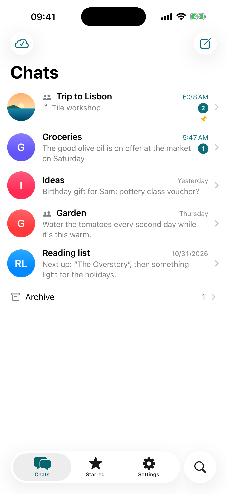
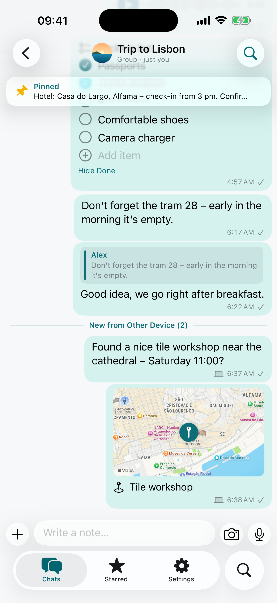
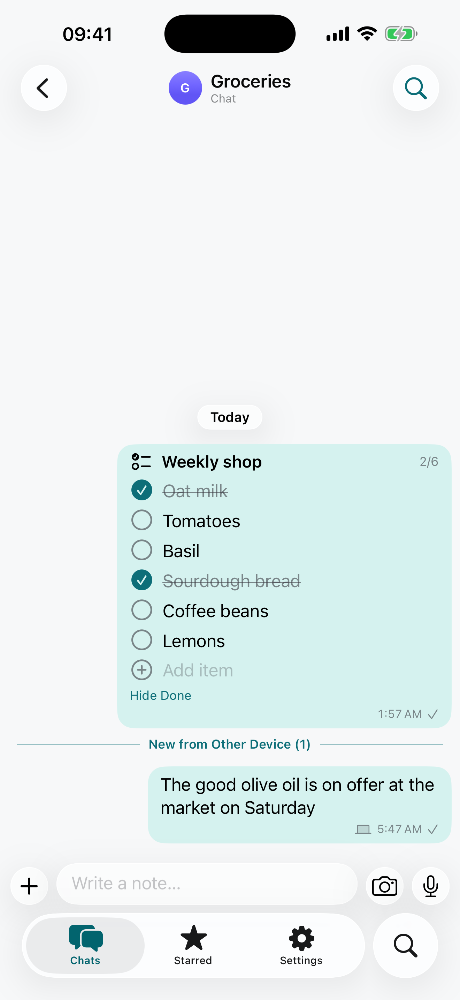
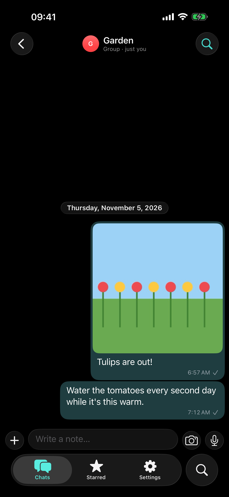
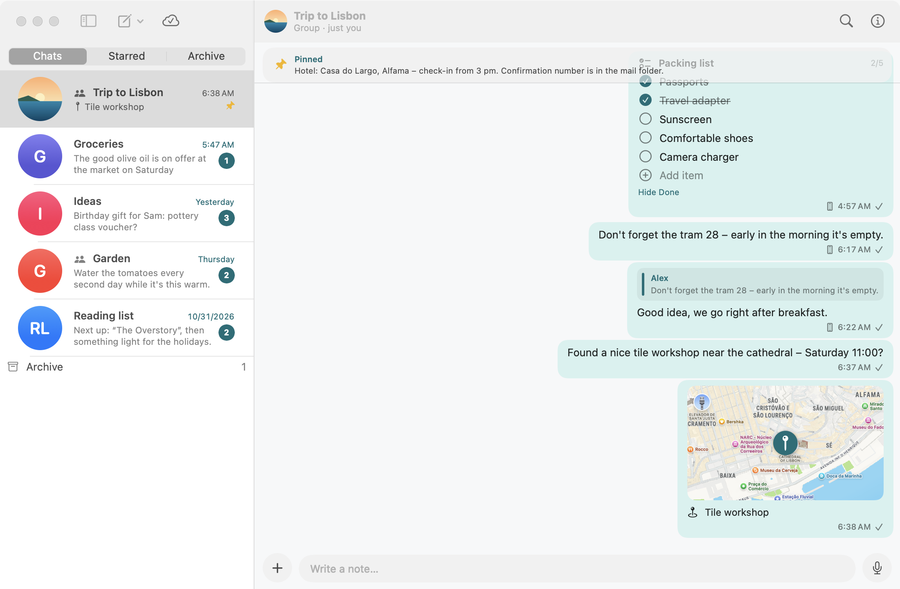

# HomeThread

**Your notes as chats – on iPhone and Mac, synced through your own server. Messenger look and feel, but nothing is ever sent to anyone.**

HomeThread looks and works like a classic secure messenger: a chat list with avatars and badges, bubbles, voice notes, photos, polls, reactions, pinned and starred entries, groups with a picture and an info page. But every "chat" is a note room just for you. Write a shopping list into *Groceries*, collect links in *Ideas*, plan a trip in a *Trip to Lisbon* group – and find it again on your Mac a second later.

Everything is stored on the device first (offline-first) and synced with a small server you run yourself (Docker, about 60 MB RAM). Groups are designed so that later more people on the same server can join a room.

> **Status:** first release. UI in **English and German** (follows the system language). Code comments are in German.
>
> Built with help from [Claude Code](https://claude.com/claude-code). Inspired by the design of open-source messengers – no code, translations or icons were copied; all layouts, texts and the icon are our own.
>
> **Personal project:** no guarantees, no support promises. Bug reports and pull requests are welcome, but I answer when I have time.
>
> Part of the HomeRoll family – see also [HomeRoll](https://github.com/silentprovider423/HomeRoll) (photos on your own Immich server).

<p align="center">
  
  
  
  
</p>
<p align="center">
  
</p>
<p align="center"><sub>Screenshots with invented demo content in a demo account.</sub></p>

## Features

**Chats and groups (note rooms)**
- Chat list with avatar, last entry, time, pinned rooms on top, **"new from another device"** badge, drafts
- Swipe to pin, mark as seen/new, archive, delete; context menu; archive section
- **New chat** (name + picture) and **new group** (choose people → name + picture → create)
- Group info: picture, rename, description, people list (add/remove people of your server), media & files, starred, polls, checklists, places, convert chat ⇄ group, save chat as text file, delete all entries, delete group

**Entries**
- Text with links and **bold**/_italic_, edit your own text
- **Voice notes** with waveform (record, discard, add; playback with progress)
- **Photos and videos** (camera on iPhone, photo library, up to 10 at once) – photos are resized to 2560 px and stored **without EXIF/location data**
- **Files** of any type (Quick Look preview)
- **Location** (current location or a pin on the map, with a name; static map preview, opens in Maps)
- **Polls** (single or multiple choice, live results or hidden until closed, end poll, winner marked)
- **Checklists** (tick off, add items inline, hide done items)
- **Reply/quote** (context menu or swipe right on iPhone), tap the quote to jump to the original
- **Reactions** (👍 👎 ❤️ 😂 😢 🙏 + more), **star** entries, **pin** entries to the top bar of a room
- Copy, share, delete on all devices, retry failed uploads

**Search**
- Search all chats (full text, case and accent insensitive, prefix search) with scopes: text, media, places, polls, checklists, starred
- Search inside a chat with up/down navigation

**Sync**
- Local SQLite database: the app works fully offline; every change is applied locally first and queued
- The queue is replayed when the server is reachable (idempotent operations, so retries never duplicate anything); attachments upload/download in the background
- Sync on open, pull to refresh and every 15 s while the app is in the foreground; change log on the server (`/api/sync?since=…`), deletions arrive as tombstones
- Conflicts: entries are append-only; edits, reactions, votes, checklist ticks and room settings are last-writer-wins per field

**Account and security**
- Sign in with server address, username, password and **authenticator code (TOTP)** → the device receives its own long-lived token, stored in the Keychain
- **Devices** list in Settings: rename, sign out single devices (e.g. a lost phone)
- Change password; reset password with the authenticator code (signs out all devices)

**Mac**
- Native two-column window: chats/starred/archive and search on the left, the chat on the right, info as inspector (⌘I)
- ⌘N new chat, ⇧⌘N new group, ⌘F search in chat, ⌘R sync, Return adds an entry (configurable), Settings (⌘,)

**Look**: iOS 26 Liquid Glass bars and buttons, light and dark mode, own petrol accent colour.

## Requirements

- The HomeThread server (folder [`server/`](server), Docker Compose) – see **[docs/SETUP.md](docs/SETUP.md)**
- iPhone with iOS 26 · Mac with macOS 15 or newer
- To build: Xcode 26, [XcodeGen](https://github.com/yonaskolb/XcodeGen) (`brew install xcodegen`)

## Install without a Mac

1. Set up your server ([docs/SETUP.md](docs/SETUP.md)) and create your account with the admin command (you get a password and a QR code for your authenticator app).
2. Download `HomeThread-<version>.ipa` from the latest release and install it with [SideStore](https://sidestore.io) or [AltStore](https://altstore.io). A free Apple ID is enough, the app then has to be refreshed every 7 days.
3. Open the app, enter your server address, username, password and the current code from your authenticator app.

## Build & install

```bash
git clone https://github.com/<you>/homethread.git
cd homethread
xcodegen generate
open HomeThread.xcodeproj
```

1. Set your own **bundle identifiers** in `project.yml` (defaults `org.homeroll.thread`, `org.homeroll.thread.mac`) and select your team in Xcode.
2. Scheme **HomeThread** → run on your iPhone; scheme **HomeThreadMac** → run on your Mac.
3. Unsigned IPA for sideloading: `./build-ipa.sh`. Mac app (ad-hoc signed, in `build-mac/`): `./build-mac.sh`.

### Simulator with a test account

Never use your real account for tests. Create a test user on your server (`add-user … --hidden`) and put its data into a git-ignored file:

```bash
cat > .test-account <<'X'
THREAD_SERVER=http://192.0.2.10
THREAD_PUBLIC_SERVER=https://thread.example.org
THREAD_USER=thread-test
THREAD_PASSWORD=<password of the test user>
THREAD_TOTP_SECRET=<authenticator secret of the test user>
X
xcrun simctl create "HomeThread Test" "iPhone 17 Pro Max" > .sim-udid
python3 tools/test-tokens.py      # signs in two test devices once, keeps the tokens in .test-tokens (git-ignored)
./sim-run.sh                      # build, install, start signed in (debug builds only)
./test.sh                         # unit tests, live tests against the server, UI tests
```

Debug builds read `THREAD_SERVER` + `THREAD_TOKEN` (or `THREAD_USER`/`THREAD_PASSWORD`/`THREAD_TOTP_SECRET`) from the launch environment, plus `THREAD_RESET=1`, `THREAD_OPEN=<chat>` and `THREAD_APPEARANCE=1|2`. Release builds ignore all of them.

## Privacy

- The app talks **only** to your HomeThread server (plus Apple Maps for map previews and place search).
- No analytics, no third-party SDKs, no push service.
- Device token in the Keychain (this device only); the local database and files stay in the app's container.
- Photos are re-encoded without metadata before they leave the device.
- The server stores passwords with Argon2id, requires an authenticator code, locks addresses after 3 failed attempts (escalating), has a global lock against distributed guessing, and serves nothing but `/api/` and `/auth/`.

## Project layout

```
Shared/Core/  SQLite store, API client, sync engine (AppModel), media, audio, keychain/TOTP
Shared/UI/    chat list, chat view, bubbles, input bar, composers, room info, search, settings, iPhone/Mac roots
iOS/ macOS/   app entry points, Info.plist, asset catalogs
server/       sync server (Python/FastAPI + SQLite) and Caddy, Docker Compose, server tests
Tests/        unit tests, live tests against a test account, UI tests
tools/        icon generator, string catalog builder, demo data, screenshots
```

## License

[MIT](LICENSE).

---

## Deutsch

**HomeThread** ist eine App für iPhone und Mac im Look eines klassischen Messengers – aber sie verschickt nichts an andere. „Chats“ und „Gruppen“ sind Notiz-Räume nur für dich: Text, Sprachnotizen, Fotos, Dateien, Orte, Abstimmungen und Checklisten, mit Reaktionen, Antworten, Anheften und Merken. Alles liegt zuerst auf dem Gerät und gleicht sich mit deinem eigenen Server ab. Die Oberfläche gibt es auf Deutsch und Englisch. Funktionen, Voraussetzungen und Installation stehen oben, die Server-Einrichtung in [docs/SETUP.md](docs/SETUP.md).
